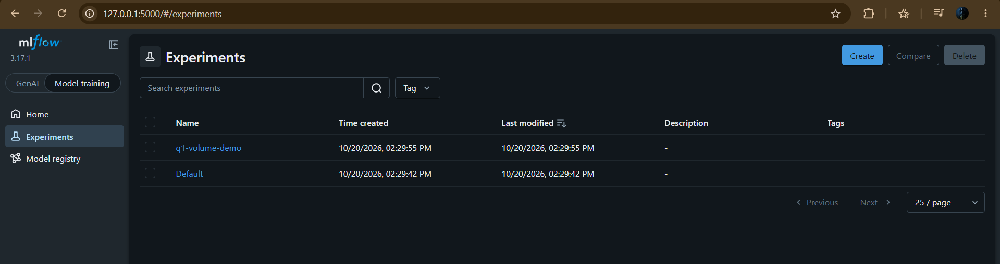
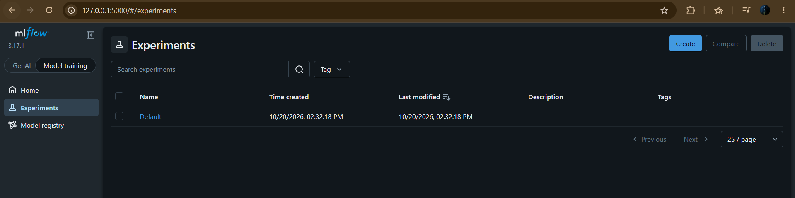
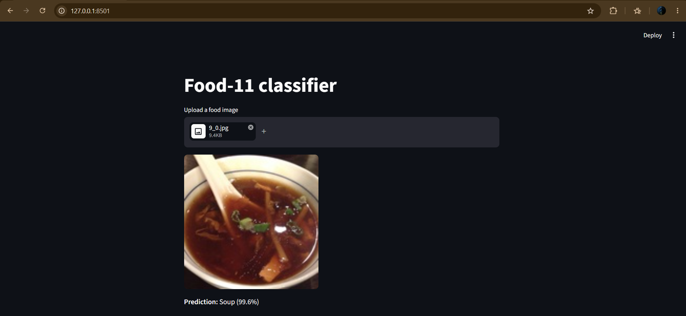
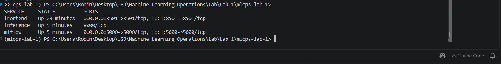
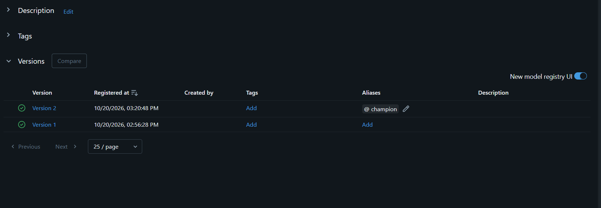

***Robin Ghassibeh (231463)***

### Question 1: What happens to everything written to `/mlflow-data` if you never mount a volume there and just `docker run` this image standalone? Try it: run the container, register nothing, stop it, remove it, start a new one from the same image — what do you see in the UI?

Everything written to /mlflow-data goes into the container's own writable layer, which is deleted together with the container. I created an experiment called q1-volume-demo, then stopped and removed the container and started a new one from the same image. The UI then shows only Default, the experiment is gone and mlflow.db is a brand new empty database.

### Question 2: Why a named volume here instead of a bind mount to a folder in your repo (the way you might for local dev)? Would a bind mount work just as well?

A named volume is managed by Docker itself, so it works the same on any machine without depending on a path inside my repo. A bind mount would also keep the data, but it would drop mlflow's database and artifacts into my project folder where git and dvc would pick them up, and SQLite on a Windows bind mount can hit file locking problems.

### Question 3: In Lab 3 you had to use `host.docker.internal` or `--network host` to reach mlflow from inside the container. In this lab, `MLFLOW_TRACKING_URI` will simply be `http://mlflow:5000`. Why does that hostname resolve now when it didn't before?

Because compose creates a private network for the project and runs its own DNS on it, so every service name resolves to that service's container. From inside the inference container mlflow resolves to 172.18.0.2. In Lab 3 the container was not on such a network, the name mlflow meant nothing there, and mlflow was on my laptop rather than in a container.

### Question 4: Why does the frontend read `INFERENCE_URL` from an environment variable instead of hardcoding `http://inference:8000`? Think about what happens if you ever `docker run` this frontend image on its own, outside Compose.

Because the name inference only exists inside the compose network. Outside it that address resolves to nothing, so a hardcoded image would be useless on its own. Reading the value from the environment keeps the same image usable anywhere, pointed at a published port or at another machine, and compose just sets the variable to the service name.

### Question 5: Only `mlflow` and `frontend` publish a port to the host. `inference` doesn't. Why not, and how does the frontend still reach it?

Nobody needs to open the API in a browser, only the frontend talks to it, and that traffic never leaves the compose network, so publishing a port would expose it for no reason. The frontend reaches it by service name at http://inference:8000. From my laptop 127.0.0.1:8000 answers nothing, while the page on 8501 still returns predictions.

### Question 6: `depends_on` here only waits for the mlflow *container process* to start, not for the tracking server inside it to be ready to accept connections. If your `serve.py` tries to load the Staging model at startup and mlflow isn't ready yet, what happens to the `inference` container? Look at `docker compose logs inference` if it fails.

It fails to start. My serve.py loads the model at startup, through the champion alias since stages are deprecated in mlflow 3, so with mlflow stopped the client retried for about five minutes and then the container exited with code 3. The log ends with Max retries exceeded for http://mlflow:5000 and Application startup failed.

### Question 7: Run `docker compose ps`. Which services have a published port listed, and which don't? Does that match what you'd expect from the `docker-compose.yml`?

frontend shows 0.0.0.0:8501->8501/tcp and mlflow shows 0.0.0.0:5000->5000/tcp, while inference only shows 8000/tcp with no arrow, so nothing is mapped to my laptop. That matches the file, where only those two services have a ports section. The inference port comes from EXPOSE in its Dockerfile and is reachable inside the compose network only.

### Question 8: Refresh the frontend and upload an image again. Does the prediction come from the new model version, or the old one? Your `serve.py` loads the model once, at startup — what single command lets you pick up the new Staging version without rebuilding any image?

It still came from the old one. I registered a second model as version 2 and moved the champion alias to it, then uploaded the same image and got Soup 47.0% again, because the container had loaded version 1 at startup and still held it in memory. The single command is docker compose restart inference, and after it the same image returned Egg 48.3%.

### Question 9: Why does `restart` alone work here — no rebuild needed? What does that tell you about what's baked into the inference image versus fetched at container startup?

Because the image only contains my code and its python environment, while the model itself is fetched from mlflow every time the process starts. Restarting runs that startup again, so it asks for champion and this time receives version 2. The image id stayed the same, so nothing was rebuilt. Only changing the code or the dependencies would need a new image.

### Question 10: Is your registered model and its Staging assignment still there after this `down`/`up` cycle? Now try `docker compose down -v` followed by `docker compose up` — what's different this time, and why?

Yes. After down and up the registry still had versions 1 and 2 with champion on version 2, because down only removes the containers and the network while the named volume stays. With down -v the volume is deleted too, so the new mlflow started on an empty database with no registered models and only the Default experiment, and inference exited again saying food11 was not found.

### Question 11: This compose file is still meant to run on one machine. What would have to change for the `inference` service to run as three replicas behind a load balancer, or for the mlflow service to survive a machine failure? (You don't need to implement this — just name what Docker Compose can't give you here.)

Compose only runs containers on one host, so it cannot spread replicas across machines or move them if that machine dies. Three inference replicas behind a load balancer need an orchestrator like Kubernetes, with a service in front to share the traffic. For mlflow to survive a machine failure its data cannot sit in a local volume, it needs a managed database and object storage instead.
