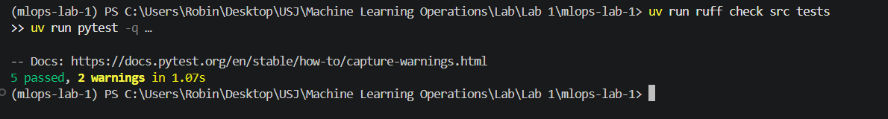
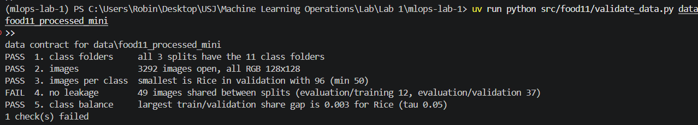
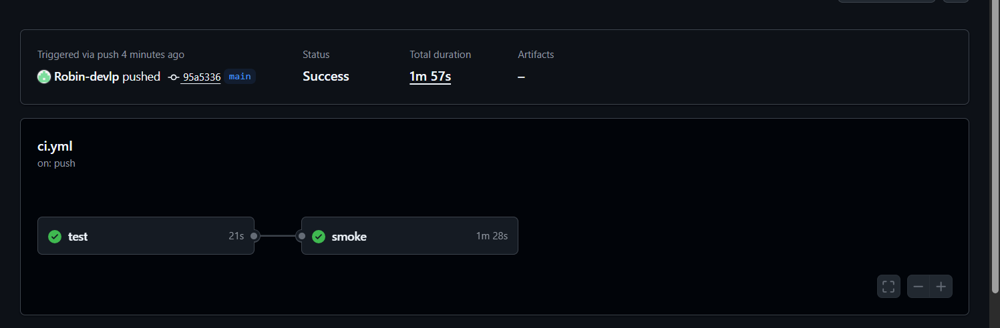
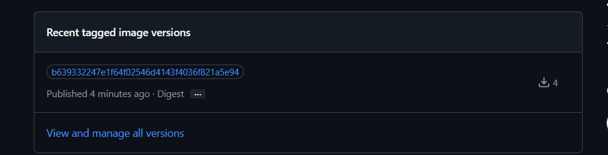
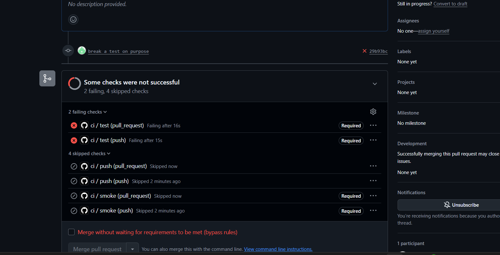
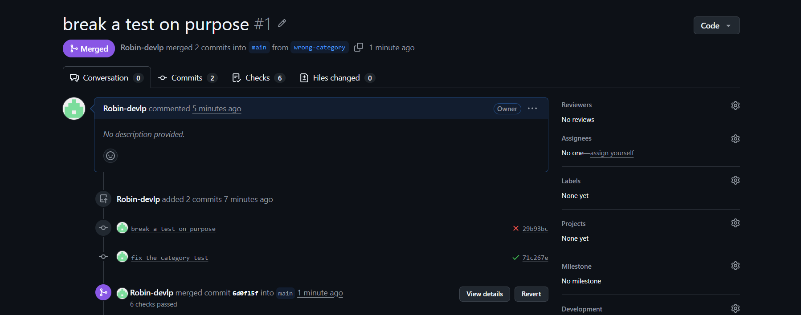
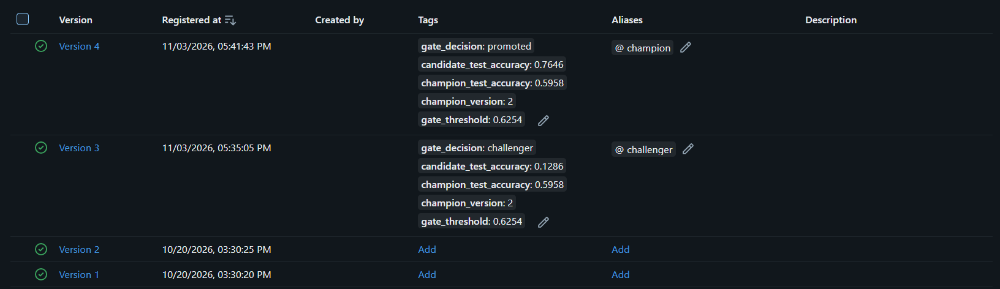
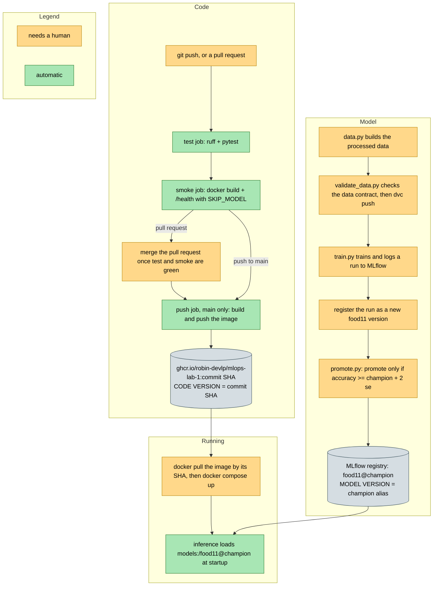

***Robin Ghassibeh (231463)***

### Question 1: Why is it a bad idea for a unit test to load the real model from your MLflow server? List at least two ways the test could fail even though your code is correct.

A unit test should only check my own code, quickly and the same way every time, and loading the real model ties it to things outside the code. If the MLflow server is down, like on a CI runner that cannot reach my laptop, the test fails after minutes of retries. If someone moves the champion alias, the predictions change and the assertions break even though nothing in my code changed.

### Question 2: The fake model always answers "Bread" with 0.90 confidence. What exactly does `test_predict_returns_valid_json` prove, and what does it *not* prove?

It proves the code around the model works: the endpoint accepts an upload, decodes the JPEG, maps the top score to the right class name and returns JSON with a confidence between 0 and 1. It does not prove the real model loads from MLflow or predicts well. My serve.py applies a softmax, so the fake 0.90 came back as 0.1958, and the test still passed since it only checks the range.

### Question 3: Which check caught it? Why is a train/test duplicate more dangerous than a corrupted image, even though the corrupted image makes the training script crash and the duplicate does not?

Check 4, the leakage check, caught it: evaluation/training went from 12 to 13, while every other check passed because the copy is a valid 128x128 RGB image. A corrupted image crashes training loudly, so it gets fixed. A duplicate fails silently, since the model is tested on a picture it already saw and the test accuracy looks better than it is. My mini data already had 49 such duplicates from the original dataset.

### Question 4: Your CI runner cannot see your data (it is in DVC, and maybe in a local remote). Where in your workflow should `validate_data.py` run so that it still protects you? Give two places.

First, right after data.py builds the processed folders and before dvc add and dvc push, for example as a pre-push hook on my laptop, so broken data never gets a version. Second, at the start of training before the model sees any data, so no run is trained on data that breaks the contract. A CI job could also run it after a dvc pull from DagsHub, with the token stored as a secret.

### Question 5: The `smoke` job has `needs: test`. What happens to it if a unit test fails? What would happen without `needs`?

With needs: test the smoke job only starts once test has succeeded, and if a unit test fails it is skipped, so no time goes into building an image from broken code. In my first run smoke waited for test, which took 21 seconds, and then ran for 1m 28s. Without needs both jobs would start at the same time, so the image would be built and probed even when the tests fail.

### Question 6: How long did the whole run take? Run it a second time (push an empty commit with `git commit --allow-empty -m "ci"`) and compare. Which step got faster, and why?

The first run took 1m 57s and the second about 2 minutes, so nothing really got faster. The uv cache from enable-cache was saved after run 1 and restored in run 2, but it was only 3 KB, because setup-uv drops downloaded packages before saving, and uv sync already took 4 seconds on GitHub's fast network. The slow step is the 80 second docker build, which the smoke job does not cache at all.

### Question 7: This answers Question 9 of Lab 3. Why tag with the commit SHA rather than `latest`? Describe a concrete situation where `latest` leads two machines to run different code.

A SHA tag points to one build of one exact commit and never moves, so the image can always be traced back to its code and pulled again identically. latest moves with every push: if one server pulls it on Monday and a second one on Wednesday after I pushed a change, both say latest but run different code. This happened to me with python:3.13-slim, which now points to a different image than in Lab 3.

### Question 8: Why does the `push` job declare `permissions:` explicitly? What could a compromised step do with a token that had write access to everything in the repo?

So the token only gets what this job needs, reading the code and writing packages, and nothing more. Every step can read that token, including third party actions like docker/build-push-action, so a compromised one could only push images. With write access to everything it could push malicious commits to main, delete branches and tags, or publish a release with a backdoor that everyone then runs.

### Question 9: What does the pull request page show? Could you still merge? What does that change for a team compared to "everybody runs the tests on their laptop before pushing"?

The page showed 2 failing and 4 skipped checks: test failed for both the push and the PR, smoke was skipped and the Merge button was greyed out. A teammate could not merge, only I could tick a bypass box as the owner. After the fix all 6 checks passed and I merged it. For a team the server runs the tests on every change, so nobody can forget them or merge code that only works on their laptop.

### Question 10: For each candidate, what did the gate decide, and with which numbers? With your test-set size, how many accuracy points does `2 * se` represent?

The champion was version 2 at 0.5958, and with n = 1096 its se was 0.0148, so a candidate needed at least 0.6254. Version 3, trained with a learning rate of 0.000001, got 0.1286 and became the challenger while champion stayed on version 2. Version 4 with my best settings got 0.7646 and was promoted. With my test set 2 * se is about 3 accuracy points, and about 2.6 around the new champion's 76%.

### Question 11: `promote.py` needs to reach your MLflow server, so it cannot run in GitHub's cloud runners while MLflow lives on your laptop. Name two ways to make it run automatically after training. (Hint: DagsHub also offers a hosted MLflow server per repository.)

First, move MLflow off my laptop, for example to the hosted MLflow server DagsHub gives every repository, store its token as a GitHub secret and add a workflow job that runs promote.py after training. Second, keep MLflow local and run the gate where it can be reached: call promote.py at the end of train.py, or register a self-hosted GitHub runner on my laptop so the workflow job runs on a machine that sees the server.

### Question 12: Draw (in `lab/lab5.md`) the pipeline you now have, from `git push` to a running container. Mark which steps are automatic, which still need a human, and where the code version and the model version are decided.

My drawing is below, green steps are automatic and yellow ones need me. Everything between a push and a published image is automatic: GitHub runs ruff and pytest, builds and probes the container, and on main pushes the image to ghcr.io. A human still merges pull requests, prepares and validates the data, trains, registers and runs promote.py, and starts the containers. The code version is decided by the commit SHA in the image tag, and the model version by the champion alias that promote.py moves.

