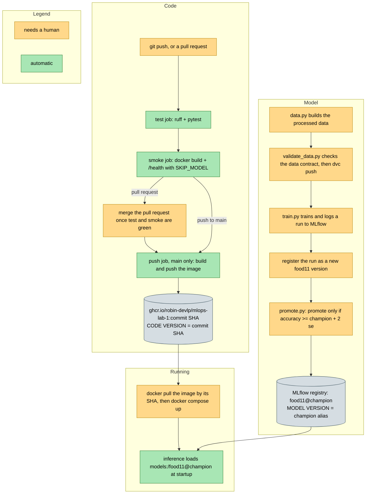

***Robin Ghassibeh (231463)***

### Lab 5 pipeline, from git push to a running container

Green steps run by themselves on every push, yellow steps still need me. The code version is fixed when the push job tags the image with the commit SHA, and the model version is fixed when promote.py moves the champion alias, so the two are released independently and only meet when the inference container starts.
